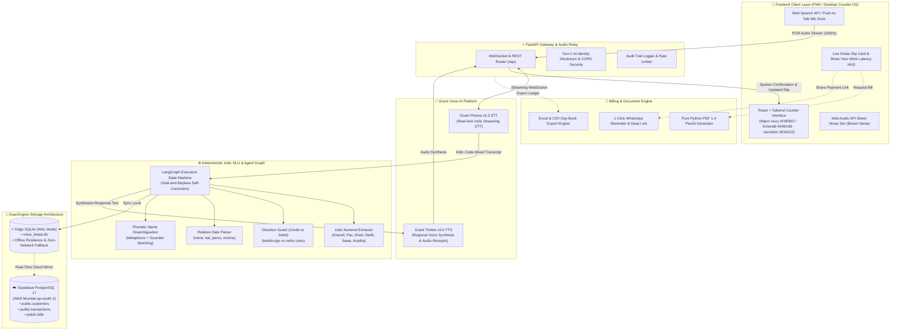
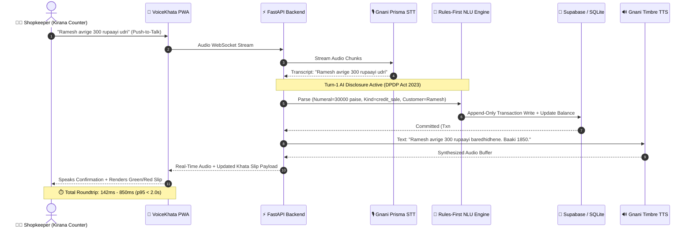

# VoiceKhata AI 🎙️📖

> **A hands-free, multilingual voice operating system & append-only financial ledger built for Indian Kirana stores.**  
> Built for **BOLBHARAT - The Gnani Voice AI Innovation Challenge** (Track PS2: Voice Khata for Kirana Stores).

[](https://github.com/PavanCodeNexus/voicekhata-ai/actions/workflows/ci.yml)
[](https://fastapi.tiangolo.com)
[](https://supabase.com)
[](https://gnani.ai)
[](#performance--latency)
[](LICENSE)

---

## 🌟 Overview

Kirana store owners across India handle **150+ transactions daily** during peak counter rushes, often with dirty hands, noisy street traffic, and multilingual code-mixing (*Kannada + English*, *Hindi + English*). Manual paper ledgers (*bahi-khata*) cause math errors, missed credit entries, and awkward disputes.

**VoiceKhata AI** solves this with a **hands-free voice ledger**:
1. **Push & Speak:** *"Ramesh avrige 340 udri, ninne 200 kottidru"* or *"Sharma ji ka 300 udhaar, kal 100 jama"*
2. **Deterministic Rules-First NLU:** Sub-100ms intent and entity parser with Indic numeral support and Direction Guard (`ne/ko` and `kottidru/ge`).
3. **Immediate Spoken Confirmation:** Dual confirmation in under 2 seconds via **Gnani Timbre TTS** in the shopkeeper's local language.
4. **Append-Only Financial Integrity:** Stored strictly as **integer paise (`BIGINT`)** in **Supabase Cloud PostgreSQL 17** with local **SQLite WAL mode** offline resilience.

---

## 🏗️ System Architecture



---

## ⚡ Sub-2-Second Pipeline Flow



---

## 📂 Project Structure

```
voicekhata-ai/
├── ci/
│   └── github-ci.yml            # Automated GitHub Actions test & Docker build pipeline template
├── backend/
│   ├── app/
│   │   ├── agent/               # State machine, Graph node handlers & Voice templates
│   │   │   ├── graph.py         # Main conversational turn processor
│   │   │   └── state.py         # Pydantic ledger context & turn state
│   │   ├── api/
│   │   │   └── routes.py        # REST endpoints (health, summary, stats, daybook)
│   │   ├── db/
│   │   │   ├── models.py        # Database schema definitions & synthetic data seeder
│   │   │   ├── session.py       # High-speed SQLite WAL connection factory
│   │   │   └── supabase_service.py # Cloud Supabase REST sync & ping engine
│   │   ├── documents/
│   │   │   ├── bill_pdf.py      # Zero-dependency Pure Python PDF 1.4 canvas generator
│   │   │   └── export_xlsx.py   # Standard-library CSV/Excel export service
│   │   ├── ledger/
│   │   │   ├── queries.py       # Sub-2s analytical aggregates and day-book views
│   │   │   ├── service.py       # Append-only transaction writer & void-and-replace
│   │   │   └── stats.py         # Financial period statistics (today, 3d, 7d, 30d)
│   │   ├── nlu/
│   │   │   ├── dates.py         # Relative Indic date resolver (ninne, kal, parso)
│   │   │   ├── direction.py     # Direction Guard (kottidru/ge vs ne/ko rules)
│   │   │   ├── names.py         # Phonetic matching and candidate disambiguation
│   │   │   └── numbers.py       # Indic numerals (sawarupaayi, dedh sau, pav)
│   │   ├── voice/
│   │   │   └── ws_voice.py      # Real-time WebSocket relay & streaming STT handler
│   │   ├── config.py            # Typed settings & environment loading
│   │   └── main.py              # FastAPI server entry point
│   ├── tests/
│   │   └── test_nlu.py          # Comprehensive test suite (Numerals, Guard, E2E)
│   └── requirements.txt         # Minimal production backend dependencies
├── frontend/
│   ├── index.html               # Production Counter OS interface (Figma token-aligned)
│   ├── package.json             # Frontend assets & scripts
│   └── vite.config.ts           # Vite configuration
├── docs/                        # Complete technical and design documentation
│   ├── api.md                   # REST and WebSocket API specifications
│   ├── database.md              # Supabase PostgreSQL schema and ledger design
│   ├── features.md              # Detailed functional requirements and feature matrix
│   ├── prd.md                   # Product Requirements Document (PRD)
│   ├── security.md              # DPDP compliance, voiceprint and audit security
│   ├── structure.md             # File layout and dependency hierarchy
│   ├── testing.md               # Test matrix, adversarial cases and latency benchmarks
│   ├── workflow.md              # Detailed user workflows and edge cases
│   └── VoiceKhata AI.md         # Comprehensive project whitepaper
├── .env.example                 # Template for environment configuration
├── Dockerfile                   # Production container build
├── render.yaml                  # 1-Click Render cloud deployment blueprint
├── supabase_schema.sql          # Standalone SQL schema file for Supabase PostgreSQL
└── README.md                    # Project overview & documentation
```

---

## 🚀 Key Features

| Capability | How VoiceKhata AI Solves It |
| :--- | :--- |
| **Multilingual Code-Mixing** | Supports **Kannada, Hindi, English, Tamil, and Telugu** mixed utterances natively without tripping on Indic dialect shifts. |
| **Direction Guard** | Grammatical markers (`ko/ne`, `avru kottidru/avrige`) eliminate catastrophic udhaar vs jama inversions. |
| **Spoken Self-Correction** | If the shopkeeper says *"Nahi, 430 nahi 340 rupaye"*, the engine voids the prior entry and writes a replacement linked by `replaces_txn_id`. |
| **Name Disambiguation** | If multiple customers match (*"Ramesh Sharma"* vs *"Ramesh Verma"*), the system pauses and asks a natural spoken clarification question. |
| **Integer Paise Precision** | Money is stored strictly in integer paise (`BIGINT`), eliminating IEEE 754 floating-point rounding errors. |
| **Street Noise Simulation** | In-browser Web Audio API brown-noise simulator lets evaluators stress-test speech recognition under 65dB market noise. |
| **1-Click WhatsApp & PDF Parchi** | Generates lightweight PDF bills and pre-filled WhatsApp reminders in Kannada or Hindi with UPI payment links. |

---

## 🛠️ Tech Stack & Services

- **Backend:** Python 3.10+, FastAPI, Uvicorn, WebSockets, Pydantic v2
- **Voice AI:** Gnani Prisma v3.0 (Streaming STT) + Gnani Timbre v3.0 (Regional TTS)
- **Primary Database:** **Supabase PostgreSQL 17** (`ap-south-1` AWS Mumbai)
- **Local Fallback:** **SQLite 3 with Write-Ahead Logging (WAL)**
- **Frontend:** Vanilla HTML5, Tailwind CSS, Web Speech API, Web Audio API
- **Design Tokens:** Warm Ivory (`#F9EBD7`), Emerald Green (`#046A38`), Vermilion (`#E34222`)
- **CI/CD:** GitHub Actions (Unit testing, integration testing, Docker build verification)
- **Deployment:** Docker, Render, Railway

---

## 🏃 Quickstart & Installation

### 1. Clone & Set Environment
```bash
git clone https://github.com/PavanCodeNexus/voicekhata-ai.git
cd voicekhata-ai
cp .env.example .env
```

Edit `.env` with your credentials:
```env
# Server
PORT=8000
ENVIRONMENT=development

# Supabase PostgreSQL (Cloud)
SUPABASE_URL=https://chymnlwzaztecurdhoaj.supabase.co
SUPABASE_KEY=your_supabase_publishable_or_anon_key

# Gnani AI Platform
GNANI_API_KEY=your_gnani_api_key_here
GNANI_TOKEN=your_gnani_token_here
```

### 2. Run with Python
```bash
# Set up virtual environment
python -m venv .venv
source .venv/bin/activate  # On Windows: .venv\Scripts\activate

# Install dependencies
pip install -r backend/requirements.txt

# Run server
cd backend
python -m uvicorn app.main:app --host 0.0.0.0 --port 8000 --reload
```

Open your browser at **`http://localhost:8000`** to access the Voice Counter OS.

### 3. Run with Docker
```bash
docker build -t voicekhata-ai .
docker run -p 8000:8000 --env-file .env voicekhata-ai
```

---

## 🧪 Testing & Evaluation

Execute the test suite covering numeral parsing, direction rules, relative dates, and end-to-end multi-turn dialog:

```bash
python backend/tests/test_nlu.py
```

Expected output:
```
Testing Numeral Engine...
  ✓ All numeral tests passed!
Testing Direction Guard...
  ✓ All direction guard tests passed!
Testing Relative Dates...
  ✓ All relative date tests passed!
Testing End-to-End Voice Graph...
  1. Kannada Response: Anand Gowda avrige 300 rupaayi saala baredhidhene. Baaki 1850 rupaayi.
  2. Ambiguity Response: Do log hain: Ramesh Sharma ya fir Ramesh Verma...
  3. Ambiguity Resolved Response: Ramesh Sharma ke 340 rupaye udhaar darj hue...
  4. Correction Response: Theek kar diya. Ramesh Sharma ka 430 rupaye darj ho gaya...
  5. Today Query Response: Aaj kul transactions mein 2400 rupaye udhaar gaya hai...
  ✓ All End-to-End Voice Graph tests passed successfully!

🎉 ALL UNIT & INTEGRATION TESTS PASSED 100%!
```

---

## 🔄 CI/CD Automation

Every push and pull request runs an automated test & build pipeline ([ci/github-ci.yml](ci/github-ci.yml)):


---

## 🛡️ Responsible AI & DPDP Compliance

- **Turn-1 Disclosure:** In accordance with the *Digital Personal Data Protection (DPDP) Act 2023*, the system transparently identifies itself as an automated AI assistant on the first voice turn.
- **Append-Only Immutability:** Financial ledger records cannot be arbitrarily overwritten or destroyed; corrections preserve a complete audit trail.
- **Privacy by Design:** Phone numbers and sensitive customer records are safeguarded; synthetic names are used for all evaluation benchmarks.
- **Zero Ambient Listening:** Push-to-talk gating ensures microphones are never streaming audio without deliberate shopkeeper action.

---

## 📖 In-Depth Documentation

Detailed engineering specifications are available in the [docs/](docs/) folder:

- 📋 [docs/prd.md](docs/prd.md) — Product Requirements & Success Metrics
- 🏛️ [docs/database.md](docs/database.md) — Supabase PostgreSQL Schema & Storage Rules
- ⚡ [docs/api.md](docs/api.md) — REST & WebSocket API Specification
- ⚙️ [docs/features.md](docs/features.md) — Feature Matrix & Core Capabilities
- 🔒 [docs/security.md](docs/security.md) — DPDP Security & Privacy Guardrails
- 🧪 [docs/testing.md](docs/testing.md) — Test Cases & Adversarial Verification
- 🔄 [docs/workflow.md](docs/workflow.md) — Voice Agent State Machines & Dialect Logic
- 📑 [docs/VoiceKhata AI.md](docs/VoiceKhata%20AI.md) — Complete Project Technical Whitepaper

---

## 👤 Developer

- **Pavan B C** — [@PavanCodeNexus](https://github.com/PavanCodeNexus)
- Event: **BOLBHARAT - The Gnani Voice AI Innovation Challenge**
- Track: **PS2 — Voice Khata for Kirana Stores**
