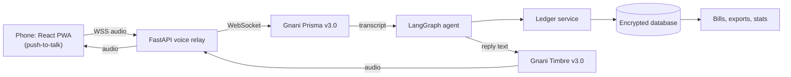

# VoiceKhata AI

A hands-free, multilingual voice ledger for kirana stores. Hold the mic, say "Ramesh ka 340 udhaar, kal 200 diya tha" (or the same in Kannada with English mixed in), and the customer ledger and the daily day-book update together. Ask "Ramesh ka total?" and hear the answer.

Built for Build Bengaluru 2.0, Gnani Voice Hackathon, Track PS2 (Voice Khata for kirana stores). Team NeuralNexus.

## Features

- Voice entries for credit, payments, cash sales and expenses, with exact amounts, direction check, relative dates and spoken corrections
- Spoken answers in about 2 seconds
- Customer ledger, daily day-book, owner statistics (today, 3, 7, 30 days)
- Bills (PDF), Talking Bill voice receipt, exports to Excel, CSV and PDF
- Customer Memory (opt-in) with greeting card and rule-based offers
- Show-your-work panel with live latency per step

Full list: docs/features.md

## Gnani API Platform services used

| Service | Model | Used for |
|---|---|---|
| Speech to text | Prisma v3.0 | Streaming recognition of Indian languages and code-mix |
| Text to speech | Timbre v3.0 | Spoken replies and voice receipts (stock voices, no cloning) |

## Architecture



Details: docs/workflow.md (flows), docs/database.md (schema), docs/security.md.

## Setup

Requirements: Python 3.11 or newer, Node 18 or newer, a Gnani API key.

```bash
# 1. configure secrets (never commit .env)
cp .env.example .env
# edit .env and add your keys

# 2. backend
cd backend
python -m venv .venv
source .venv/bin/activate          # Windows: .venv\Scripts\activate
pip install -r requirements.txt
alembic upgrade head
python ../scripts/seed_demo.py     # synthetic shop and customers
uvicorn app.main:app --reload --port 8000

# 3. frontend (new terminal)
cd frontend
npm install
npm run dev
```

Open the printed URL on your phone (same network, HTTPS needed for the mic outside localhost).

Optional, for Shop Lock: pip install -r backend/requirements-optional.txt

First-time frontend scaffold (if the folder is empty):
```bash
npm create vite@latest frontend -- --template react-ts
cd frontend && npm install recharts vite-plugin-pwa
```

## Tests and evaluation

```bash
pytest backend/tests
python eval/run_eval.py --noise 10 --out eval/scoreboard.md
```

Latest results: see eval/scoreboard.md (paste the table here before submission).

## Responsible AI

- The agent says it is an AI in its first turn, in the user's language.
- Synthetic or consented data only. Transcripts are encrypted and deleted after judging.
- No lending, no pressure language. Reminders are opt-in drafts only.
- No voice cloning. No ambient recording. Customer Memory is opt-in and deletable by voice.
- API key lives only in .env (listed in .gitignore).

## Docs

prd.md, features.md, structure.md, workflow.md, database.md, api.md, security.md, testing.md in /docs.

## Team

NeuralNexus. Lead: Pavan B C.
