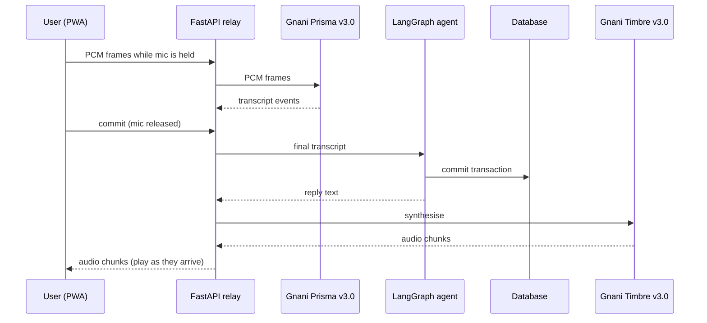
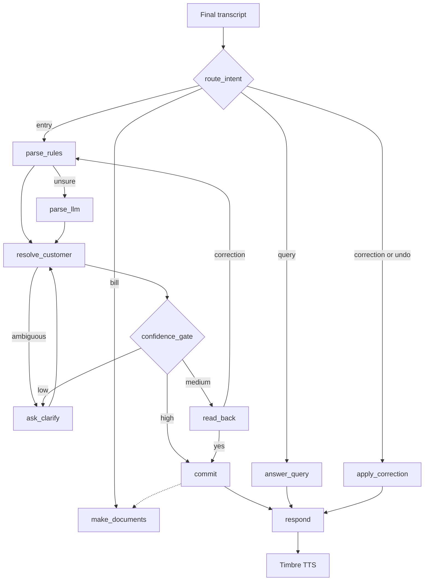

# VoiceKhata AI: Workflows

## 1. Voice pipeline

Rules:
- The relay holds the Gnani key and sets the handshake headers. The browser never sees the key.
- Pressing the mic while audio plays stops playback and cancels the TTS request (barge-in).
- Each stage is timed (STT final, parse, DB, TTS first audio) and sent to the latency HUD.

## 2. Agent graph (LangGraph)

State fields: transcript, language, speaker_id, role, intent, customer candidates, amount_paise, kind, txn_time, items, confidence, pending_question, result, timings.

Persistence: a checkpointer keeps the state so a pending question ("Which Ramesh?") survives until the next utterance.

Confidence zones:
| Zone | When | Action |
|---|---|---|
| High | Customer, amount, direction, date all clear; amount below the large-amount limit | Commit, speak a short confirmation |
| Medium | Two readings of the amount differ, direction unclear, noisy transcript, or large amount | Read back, wait for yes or a correction |
| Low | Amount or customer cannot be found | Ask one specific question, write nothing |

## 3. Spoken query flow

1. Intent = query ("Ramesh ka total?", "Aaj kitna udhaar gaya?", "Explain Ramesh's balance").
2. Run SQL (views in database.md). No LLM.
3. Fill a template in the user's language (numbers spoken as words for Timbre).
4. Target: first audio within 2 s of the end of the question.

## 4. Correction and undo flow

1. "alla, 430" / "nahi, 430": find the last active entry by this user.
2. Mark it void (status, voided_at, void_reason) and insert a new entry with replaces_txn_id.
3. Speak: "Corrected: Ramesh, 430 credit."
4. "Cancel last entry": void only. Workers can undo their own last entry within 5 minutes; the owner can void any entry (PIN).

## 5. Bill, Talking Bill and sharing

1. After commit, a background job creates the bill (PDF) with the next bill number.
2. Talking Bill (optional): short script in the customer's language, synthesised with Timbre v3.0. Only for customers who opted in.
3. The PWA shows "Share": the phone share sheet with the PDF and audio attached, or a wa.me text link.
4. Sharing always needs an explicit tap by the shopkeeper. No automatic sending in v1.

## 6. Customer Memory flow (opt-in)

1. New customer: the agent says it is an AI and asks for consent in the customer's language. Save only on yes.
2. Save name, language, notes the shopkeeper dictates. Visit count and purchases come from the ledger.
3. Next visit: the shopkeeper says "Ramesh is here". The screen shows a greeting card (last purchases, notes) and any offer that matches a rule (visit count or spend, capped at 20 percent).
4. "Delete Ramesh's data" by voice removes memory, aliases and consents, and writes an audit entry.

## 7. Shop Lock flow (stretch)

1. Enrol the owner and up to 3 workers with consent (15-20 seconds of speech each). Store only the encrypted voiceprint vector.
2. Each utterance: embed the audio and compare with the voiceprints. High score accepts and stamps who spoke. Middle score accepts with read-back. Low score ignores the audio and discards it.
3. Modes: Open (default for judges) and Shop Lock. Owner can start a 10-minute guest mode.

## 8. Data lifecycle

| Data | Kept | Deleted |
|---|---|---|
| Transcripts | Encrypted, 24 h TTL | Purge job; all removed after judging |
| Voiceprints | Encrypted vectors only | On request or when consent is revoked |
| Ledger | Append-only | Demo data wiped after judging |
| Exports | Short-lived files | After 24 h |
| Audit log | Actions only, no raw PII | Per retention setting |

## 9. Development workflow

- Branches: main (always runnable), feature/<name>. Merge small and often.
- Commits: "nlu: add dhai sau idiom". Tests with the code.
- Pre-commit: ruff, gitleaks. CI (if time): pytest + gitleaks.
- Definition of done for a feature: works in the demo path, has a test or eval phrase, no secrets or PII in logs, features.md checkbox ticked.
- Freeze: no new features in the last 2 hours. Only fixes.

## 10. 24-hour build plan (adjust to team size)

| Hours | Focus | Outcome |
|---|---|---|
| 0-2 | Setup | Repo, .env, FastAPI relay skeleton, DB, PWA shell, seed script |
| 2-8 | Voice loop | Mic to Prisma to transcript to Timbre echo; push-to-talk, commit, barge-in, timings |
| 8-12 | Ledger agent | Parsers, LangGraph, entries, corrections, disambiguation, spoken answers |
| 12-16 | Business layer | Day-book, bill PDF, exports, owner stats |
| 16-20 | Judge-impact | Work panel + latency HUD, language switch, explain balance, delete-my-data, Customer Memory, Talking Bill if time |
| 20-22 | Harden | Noise tests, eval scoreboard, security checklist, Shop Lock only if stable |
| 22-24 | Ship | README with diagram, 2-3 min video, deck (6 slides), reset demo data |

## 11. Demo script (about 3 minutes)

1. AI disclosure in the judge's language.
2. Judge speaks an entry (any language, with noise playing). Show heard, understood, saved with timings.
3. Correction: "alla, 430". Two customers with one name: "Which Ramesh?".
4. Ask "Ramesh ka total?" and show the stopwatch.
5. Interrupt the agent mid-sentence (barge-in).
6. Switch language mid-session.
7. Bill with Talking Bill. Customer Memory greeting for a returning customer.
8. (Optional) Shop Lock: an enrolled voice works, another is ignored, then back to Open mode.
9. Delete a customer's data by voice and show the purge log.

## 12. Pre-event checklist (17-20 November)

- [ ] Gnani account and API key, key in .env only
- [ ] One STT call and one TTS call working
- [ ] 100 test phrases in eval/phrases.csv (Kannada, Hindi, English mixes)
- [ ] Noise clips and a noise-mix script
- [ ] Hindi-speaking volunteers for test recordings
- [ ] Answers from organizers on the open questions in prd.md
- [ ] README and deck skeletons
- [ ] Roles: voice pipeline, agent and NLU, backend and DB, frontend and demo
